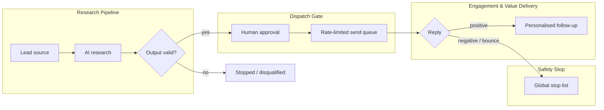

# AI-Assisted B2B Outreach Engine — Case Study

> 🇵🇱 Polish version: [README.pl.md](README.pl.md)

A high-level case study of an AI-assisted B2B outreach automation system built for a B2B consulting company.
This repository is a **portfolio description only**. It contains no source code, workflow exports, prompts,
data schemas, configuration or operating parameters — all of those are the property of the client
and remain confidential.

---

## Project at a glance

| | |
|---|---|
| **Client** | B2B consulting company (name withheld) |
| **Period** | July 2026 – October 2026 |
| **Role** | AI Automation Architect — design, implementation, deployment and testing |
| **Engagement** | Fixed-scope project delivered in milestones with defined acceptance criteria |
| **Area** | Account-Based Marketing (ABM), workflow automation, applied LLMs |

## The problem

Personalised B2B outreach does not scale by hand: researching each company, writing a relevant
first message and following up takes hours per lead. Fully automated mass mailing scales, but it is
impersonal, risky for sender reputation and hard to keep compliant.

The goal was a system that does the repetitive research and preparation automatically, while keeping
a human in control of every message that goes out — and that fails safe whenever something looks wrong.

## The solution (high level)

The system is a self-hosted automation engine that takes a lead from discovery to a closed outcome:

1. **Sourcing** — new leads are pulled from a B2B data provider on a schedule.
2. **AI research** — a language model analyses the lead's public website and extracts business signals
   relevant to the offer.
3. **Validation** — AI output is checked before it is used; empty, broken or suspicious results stop
   the lead instead of producing a bad message.
4. **Human approval** — every prepared message waits for explicit approval by an operator.
   There is no path that sends a message without it.
5. **Controlled sending** — approved messages go through a buffered queue with volume limits and an
   emergency stop.
6. **Reply handling** — positive replies trigger delivery of personalised follow-up materials;
   negative replies, unsubscribes and bounces immediately and permanently block further contact.

## Workflows

The system is split into four independent workflows. Each has a single responsibility and
communicates with the others only through the shared lead register, so any one of them can be paused,
changed or tested without touching the rest.

### 1. Research Pipeline
Turns a raw lead into a prepared, reviewable outreach draft.
- Pulls new leads from the B2B data provider on a schedule.
- Fetches the lead's public website and sends its content to the language model for analysis.
- The model returns structured output: detected business signals and a qualification verdict.
- Output is validated (format, completeness, signs of hallucination or injected instructions).
  Anomalies — empty page, error page, no business content — disqualify or stop the lead instead of
  producing a message.
- Valid leads get a draft message, are marked as awaiting review and the operator is notified.

### 2. Dispatch Gate
The only path from an approved draft to a sent message.
- Reacts to an explicit approval made by the operator in the lead register.
- Approved items go to a buffer queue instead of being sent immediately.
- The queue is drained at safe intervals under per-domain volume limits, so a batch can still be
  stopped manually after the first messages go out (kill-switch).
- Abnormal volume or a spike in bounces halts sending automatically and alerts the client.

### 3. Engagement & Value Delivery
Handles leads who replied with interest.
- Captures positive replies from the sending platform.
- Generates a personalised voice message for the lead using an AI voice service.
- Sends a follow-up email with a dedicated landing page and personalised materials.
- Updates the lead's status in the register.

### 4. Safety Stop
A global, rule-based brake that overrides everything else.
- Captures negative replies, unsubscribe requests and bounces in real time.
- Extracts the lead's domain and adds it to a global blocklist on the sending platform.
- Flags the lead in the register so no workflow can contact it again.
- Blocking decisions are made by deterministic rules; the language model only helps interpret
  ambiguous reply text, and unclear cases go to the operator instead of being guessed.

### Cross-cutting
- **Error handling** — every critical step has a dedicated error path with retries for transient
  API failures; a lead is never silently lost.
- **Telemetry** — each AI call records latency, token usage and cost in the register.
- **Alerting** — critical failures (e.g. rejected credentials) trigger an immediate alert.

## Universal connectors

Three reusable API adapters let the client attach new channels or automations **by configuration
only** — without changing the core workflows and without the engineer's involvement.

| Connector | Purpose | Validated against |
|---|---|---|
| **Messaging connector** | Push events and notifications to team communication tools | Test team-chat channel |
| **Email connector** | Send or log messages through any mailbox | Isolated test inbox |
| **Data / CRM connector** | Sync lead records to external databases and CRMs | Test spreadsheet-based CRM |

Each connector exposes the same simple contract (event in → mapped payload out), so a new
destination means a new configuration entry, not new code.

## Design principles

- **Human-in-the-loop by construction** — the approval step is enforced by the workflow structure,
  not by convention.
- **Deterministic safety, AI for interpretation** — the safety-critical decisions (blocking, limits,
  stops) are made by plain rule-based logic; the language model only assists with understanding text.
- **Fail safe, not fail open** — when an external service or the AI returns something unexpected,
  the lead is parked or stopped rather than pushed forward.
- **Prompts separated from logic** — the client can edit and tune AI instructions without touching
  the workflows.
- **Resilience** — dedicated error-handling paths, retries for transient API failures and no lost
  records on timeouts.
- **Observability** — every AI call is logged with latency, token usage and cost; critical failures
  raise immediate alerts.
- **Extensibility** — generic connectors let the client plug in new channels by configuration only.
- **Client-owned infrastructure** — all servers, accounts and secrets belong to the client; nothing
  depends on the engineer's private resources.

## Engineering practices

- Milestone-based delivery with written acceptance criteria (Definition of Done) for each stage.
- End-to-end tests with test leads, including edge cases (broken websites, invalid AI output,
  negative replies, simulated volume spikes).
- Documentation sufficient for another engineer to rebuild and take over the system.
- Security policy: MFA everywhere, secrets only in the production environment, encrypted devices,
  no client data in public AI tools.
- Data protection handled under a GDPR data processing agreement.

## Skills demonstrated

- Workflow orchestration and low-code automation (self-hosted)
- LLM integration: structured output, validation, hallucination and prompt-injection safeguards
- Email deliverability and sending-domain setup
- State-driven process design with human approval gates
- Rate limiting, queueing and kill-switch design
- Monitoring, cost telemetry and alerting
- Working under strict security, confidentiality and GDPR requirements

## Technology

n8n (self-hosted on Hetzner VPS) · Claude API (Anthropic) · Apollo.io · Instantly.ai · ElevenLabs

## Confidentiality notice

This case study is published with the client's written consent. All intellectual property of the
delivered system — including workflows, prompts, data structures, configuration and documentation —
belongs to the client. This repository intentionally contains none of it.

---

**Author:** Michał Buczek · [LinkedIn](https://www.linkedin.com/in/michal-buczek-/)
